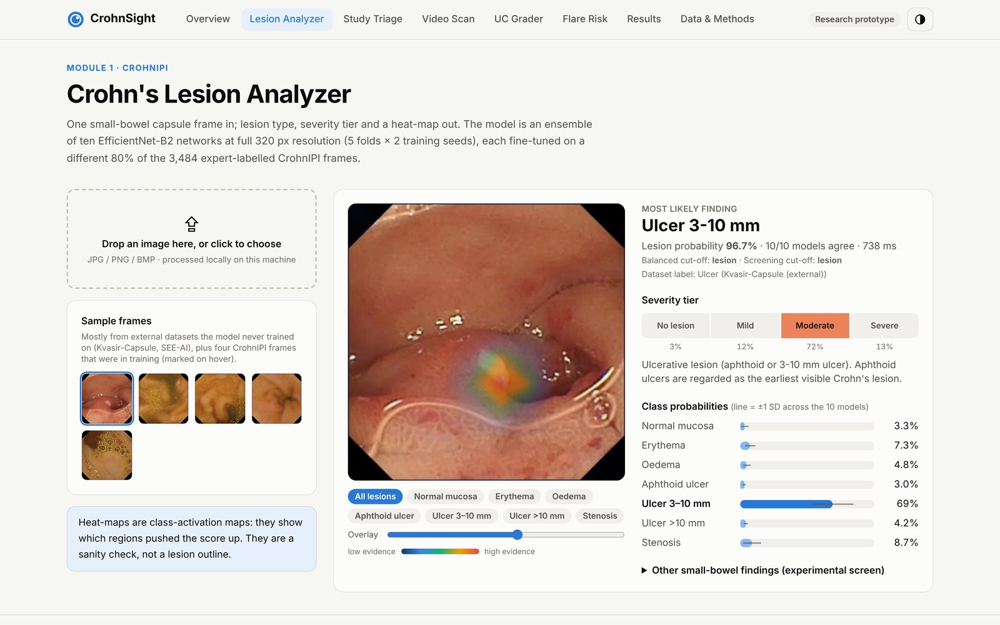

# CrohnSight

**Finds Crohn's disease lesions in capsule-endoscopy frames and videos, grades how severe they are, and shows where the model looked. It runs offline on an ordinary laptop CPU.**

[Run it](#run-it) · [Results](#results) · [How it works](#how-it-works) · [Project guide](docs/PROJECT_GUIDE.md) · [Development log](docs/DEVELOPMENT_LOG.md)



| 0.992 | 96.7% | 0.94 | 0.944 |
| :---: | :---: | :---: | :---: |
| Lesion vs normal AUROC,<br>CrohnIPI 5-fold CV | Lesion vs normal accuracy<br>(best published: 94.6%) | Severity agreement,<br>quadratic weighted kappa | AUROC on Kvasir-Capsule,<br>a dataset it never trained on |

> **Research prototype. Not a medical device.** Do not use it to diagnose or treat anyone.

## Why

A capsule endoscopy study is tens of thousands of frames, and a gastroenterologist reads every one looking for lesions that can be a few millimetres wide. CrohnSight scores each frame, ranks a study so the most suspicious frames come first, grades severity on a four-step scale, and draws a heat-map so a reader can check *why* a frame was flagged. Two add-ons cover the rest of inflammatory bowel disease: an **ulcerative colitis Mayo grader** for colonoscopy images and a **flare-risk forecaster** for follow-up visits.

## Results

Final Crohn's model: **10 × EfficientNet-B2** (5 folds × 2 seeds) at the native 320 px, trained 40 epochs on an RTX 3050 laptop GPU and exported to ONNX.

**CrohnIPI** (France), official 5-fold cross-validation, out-of-fold predictions:

| Measure | CrohnSight | Best published |
| --- | --- | --- |
| Lesion vs normal AUROC | **0.992** (95% CI 0.989–0.995) | — |
| Lesion vs normal accuracy (cross-fitted threshold) | **96.7%** | 94.6% (ResNet-34) |
| 7-class accuracy | **91.1%** (balanced 84.0%) | — |
| 4-tier severity, quadratic weighted kappa | **0.94** (97.7% within one tier) | — |

<p align="center"></p>

**External tests with no retraining** (other countries, other capsule brands):

| Dataset | Result |
| --- | --- |
| Kvasir-Capsule (Norway), all 47,238 labelled frames | Inflammatory vs normal AUROC **0.944** (CI 0.86–0.98); ulcer 0.989, erosion 0.920, erythema 0.785 |
| SEE-AI (Japan) | Erosion **0.897**, stenosis **0.916**, erythema **0.897** |
| Heat-map peak lands in the expert's lesion box | Kvasir 69% (chance 4%), SEE-AI stenosis 93% (chance 55%) |

<p align="center"></p>

<details>
<summary><b>Heat-map examples, including a miss</b></summary>
<br>

</details>

**Two operating modes.** Both cut-offs were fixed on CrohnIPI before any external test.

| Mode | Cut-off | Kvasir lesion frames caught | Kvasir normal frames flagged |
| --- | --- | --- | --- |
| Balanced | 0.50 | 79.4% | 2.6% |
| Screening | 0.31 | 93.4% | 31.6% |

**Known limits.**
- Telling a whole lesion video from a lesion-free one is near chance (study-level AUROC 0.57).
- The UC grader drops from 0.943 on LIMUC to 0.746 on a new hospital (HyperKvasir).
- The flare model ties the HBI-only baseline (AUROC 0.711).

Experiments that did not work, such as hard negatives and a quality filter, are written up in the [project guide](docs/PROJECT_GUIDE.md), section 9.

To reproduce the CrohnIPI numbers from the saved out-of-fold predictions (needs the CrohnIPI CSV, see [Data](#data)):

```bash
cd gpu
python evaluate_oof.py --runs ../results/b2_oof/seed0 ../results/b2_oof/seed1
```

## Run it

Python 3.10+ on Windows, macOS or Linux. No GPU, PyTorch or internet needed.

```bash
cd app
pip install -r requirements.txt
python run.py            # opens http://127.0.0.1:8000
```

Or with Docker: `cd app && docker compose up -d --build` (see [`app/DOCKER.md`](app/DOCKER.md)).

| Page | What it does |
| --- | --- |
| Lesion Analyzer | One frame in: 7 lesion classes, severity tier, heat-map, and how many of the 10 models agree |
| Study Triage | Many frames or a .zip in: a most-suspicious-first reading list, with a Balanced / Screening switch |
| Video Scan | Scan your own capsule video (upload it, or copy it into `app/user_videos/`), plus 43 Kvasir studies scanned offline |
| UC Grader | Colonoscopy image in: Mayo score 0–3 |
| Flare Risk | HMP2 patient timelines and a what-if flare calculator |
| Results, Data & Methods | Every number, including the negative results |

Video decoding uses OpenCV if it is installed, otherwise the ffmpeg bundled with `imageio-ffmpeg`.

## How it works

```
capsule frame ─▶ 320 px, normalise ─▶ 10 × EfficientNet-B2 (ONNX) ─▶ 7 lesion classes ─▶ severity tier
                                                    └──────────────▶ class-activation heat-map + model agreement
```

- **Ensemble.** Five cross-validation folds × two seeds. Each network is fine-tuned on a different 80% of the 3,484 expert-labelled CrohnIPI frames, and the app averages all ten.
- **Severity.** Class probabilities are summed inside each tier (none, mild, moderate, severe). That makes the grade ordinal, which is why it is scored with weighted kappa.
- **Explainability.** Class-activation maps come out of the ONNX graph, so the heat-map costs nothing extra at inference.
- **Honest evaluation.** Thresholds are chosen on other folds (cross-fitting), and recipes were fixed before scoring. External datasets were touched only once the model was final.
- **Deployment.** FastAPI serves the ONNX models with onnxruntime on CPU, and a pre-built Next.js site is the UI. There is no PyTorch at runtime.

## Repository layout

```
app/            web app: FastAPI backend, Next.js frontend (+ pre-built site), ONNX models, CC BY sample images
gpu/            GPU training and evaluation (PyTorch): train_gpu.py, evaluate_oof.py, export_to_app.py, external_gpu.py
ml/             first-phase training code (cloud CPU): linear probes, v1/v2 fine-tuning, flare model, ONNX export
ml_device/      laptop scripts (onnxruntime): features, UC/findings heads, external tests, video scans, results summary
results/        every metric as JSON; out-of-fold predictions of the final model in results/b2_oof/
docs/           project guide, development log and figures
```

## Data

No dataset is included, because of licences and size. Download them yourself and place them in a folder named `temorary solution` **next to** this repository folder (the scripts use that name):

| Dataset | Where | Licence | Used for |
| --- | --- | --- | --- |
| CrohnIPI | https://crohnipi.ls2n.fr/ (Zenodo 14616507) | CC BY-NC-ND, research use only | Training + internal test |
| Kvasir-Capsule | https://osf.io/dv2ag/ | CC BY 4.0 | External test, video tests |
| SEE-AI | Kaggle `capsuleyokote/the-see-ai-project-dataset` | See the Kaggle page | External test, findings screen |
| LIMUC | Zenodo 5827695 | CC BY 4.0 | UC grader |
| HyperKvasir | https://osf.io/mh9sj/ | CC BY 4.0 | UC external test |
| HMP2 / IBDMDB | https://ibdmdb.org | IBDMDB terms | Flare model |

Exact folder names are listed in the guide, section 12.7.

## Team

Built by [Hil Kalathiya](https://github.com/HilKalathiya) and [Sahaj Saliya](https://github.com/SahajIVVIX-1) as the 2026–27 Minor Project at Pandit Deendayal Energy University (PDEU), *AI-Based Early Prediction of Crohn's Disease Severity Using Machine Learning*. Guided by Prof. Dr. Babalu Kumar Singh.

## Licences and use

* **Code and documentation:** [MIT License](LICENSE), © 2026 Hil Kalathiya, Sahaj Saliya and Chetan Gadhiya.
* **Trained model weights and derived results:** non-commercial research and teaching only, with attribution, and no clinical use. See [MODELS_LICENSE.md](MODELS_LICENSE.md). They are derived from CrohnIPI (CC BY-NC-ND, research use only) and the other datasets, so the MIT licence does not apply to them.
* **Sample images** (`app/samples/`) come from Kvasir-Capsule, HyperKvasir and LIMUC (CC BY 4.0) and are shown with attribution. Research-use-only images (CrohnIPI, SEE-AI) are not included, and the app skips them when they are absent.
* **Not a medical device.** Research prototype only.

## Citation of the data

Vallée R. et al., *CrohnIPI*, Proc. SPIE 11317 (2020) · Smedsrud P.H. et al., *Kvasir-Capsule*, Sci Data 8, 142 (2021) · Yokote A. et al., *SEE-AI project*, DEN Open (2024) · Polat G. et al., *LIMUC*, Inflamm Bowel Dis · Borgli H. et al., *HyperKvasir*, Sci Data 7, 283 (2020) · Lloyd-Price J. et al., *IBDMDB*, Nature 569 (2019).
